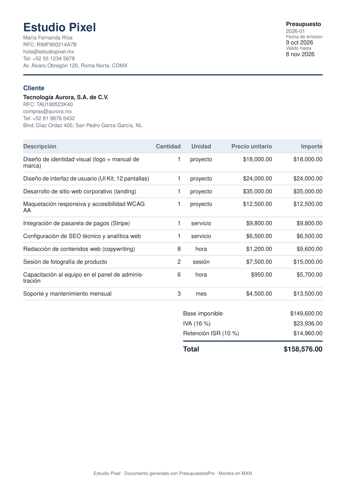

# PresupuestosPro

> Aplicación web **solo cliente** para que un freelancer cree presupuestos profesionales con su marca y los descargue en **PDF** — sin Excel, sin plantillas, sin nube.


PresupuestosPro es una SPA que calcula automáticamente base imponible, IVA (16 %) y retención de ISR opcional (10 %), genera un PDF listo para el cliente y mantiene catálogos de clientes y servicios. Toda la interfaz, el PDF y los mensajes están en **es-MX** con montos en **MXN**.

> **Sin backend real:** los datos viven en el equipo del usuario mediante un mock de backend asíncrono sobre `localStorage`. Sin cuentas, sin nube, sin correo, sin facturación fiscal.

📄 **[Ver un presupuesto de ejemplo](docs/ejemplo-presupuesto.pdf)** generado por la propia aplicación (10 líneas, es-MX/MXN).



---

## Tabla de contenidos

- [Características](#características)
- [Stack tecnológico](#stack-tecnológico)
- [Puesta en marcha](#puesta-en-marcha)
- [Scripts disponibles](#scripts-disponibles)
- [Arquitectura](#arquitectura)
- [Rutas](#rutas)
- [Reglas de negocio](#reglas-de-negocio)
- [Testing](#testing)
- [Spec-Driven Development](#spec-driven-development)
- [Decisiones de diseño](#decisiones-de-diseño)
- [Fuera de alcance (v1)](#fuera-de-alcance-v1)

---

## Características

- 🧮 **Cálculo automático de impuestos** en aritmética de centavos enteros (sin errores de coma flotante).
- 📄 **PDF generado en el navegador** con la marca del emisor, datos fiscales y del cliente, número y fechas. → [ver ejemplo](docs/ejemplo-presupuesto.pdf)
- 🏷️ **Numeración correlativa** tipo `2026-01`, con reinicio anual y sin reutilizar números eliminados.
- 👥 **Catálogos** de clientes y servicios (CRUD completo con confirmación).
- 📝 **Borradores** sin número, editables, que pasan al historial al emitirse como documentos inmutables.
- 🔄 **Cinco estados** de presupuesto: Borrador, Enviado, Aceptado, Rechazado y Caducado (calculado).
- 🇲🇽 **Localización es-MX / MXN** en interfaz, formatos y documento.
- 
**URL del proyecto:** [https://mikegalindo.github.io/presupuestosproGIt/](https://mikegalindo.github.io/presupuestosproGIt/)
---

## Stack tecnológico

| Capa | Tecnología |
|------|------------|
| UI | React 18 + TypeScript (modo estricto) |
| Build / Dev Server | Vite 5 |
| Ruteo | React Router 6 |
| PDF | `@react-pdf/renderer` (render en cliente) |
| Estado | Context + `useReducer` (estado mínimo, sin gestores globales) |
| Persistencia | Mock de backend asíncrono sobre `localStorage` |
| Testing | Vitest + React Testing Library + jsdom |

---

## Puesta en marcha

Requisitos: **Node.js 20+** y npm.

```bash
# 1. Instalar dependencias
npm install

# 2. Entorno de desarrollo (Vite) → http://localhost:5173
npm run dev
```

---

## Scripts disponibles

| Comando | Descripción |
|---------|-------------|
| `npm run dev` | SPA en modo desarrollo (Vite) |
| `npm run build` | Typecheck (`tsc`) + compilación de producción |
| `npm run preview` | Sirve la compilación de producción |
| `npm test` | Ejecuta la suite completa (unitarias + integración) |
| `npm run test:watch` | Vitest en modo watch |

---

## Arquitectura

El código está organizado por **capas de responsabilidad**, con la lógica de negocio pura separada de la UI y de la persistencia:

```text
src/
├── domain/      # Lógica pura: tipos, dinero (centavos), cálculos, validación, numeración
├── data/        # Mock de backend asíncrono + adaptador localStorage + store (Context/useReducer)
├── features/    # profile, clients, services, budgets (editor, borradores, historial, detalle), pdf
├── components/  # UI compartida (campos, tabla, estados, diálogo de confirmación)
├── lib/         # Utilidades: ids (UUID) y fechas (Intl es-MX)
└── styles/      # Estilos globales y tokens de diseño
tests/
├── unit/        # Cálculos, numeración, validación, historial/snapshot
└── integration/ # Flujos completos con React Testing Library
```

**Claves del diseño:**

- El **dominio no conoce React ni el almacenamiento**: recibe y devuelve tipos puros, lo que lo hace trivialmente testeable.
- El **mock de backend expone la misma interfaz que un backend real** (promesas, errores tipados), de modo que sustituirlo no requiera tocar a los consumidores.
- Los **montos son enteros de centavos**; el formateo a MXN ocurre solo en la capa de presentación.

---

## Rutas

| Ruta | Pantalla |
|------|----------|
| `/` | Página de inicio (resumen de actividad y accesos) |
| `/perfil` | Perfil del emisor (marca, RFC, logo) |
| `/clientes` | Catálogo de clientes |
| `/servicios` | Catálogo de servicios |
| `/borradores` | Borradores guardados (sin número) |
| `/presupuestos/nuevo` | Editor de presupuesto (nuevo) |
| `/borradores/:id` | Editor de presupuesto (borrador) |
| `/presupuestos` | Historial de emitidos |
| `/presupuestos/:id` | Detalle de un emitido (ver, descargar, eliminar) |

### Flujo típico

1. Configura tu **perfil** (nombre, razón social y RFC obligatorios; logo opcional) en `/perfil`.
2. Da de alta **clientes** y **servicios** en sus catálogos.
3. Crea un presupuesto en `/presupuestos/nuevo`: elige cliente, añade líneas (manuales o del catálogo), activa la retención si aplica y revisa los totales en vivo.
4. **Guardar borrador** (sin número) o **Emitir y descargar PDF** (asigna número `AÑO-NN`, fija snapshots y descarga el PDF).
5. Consulta el historial en `/presupuestos`, abre el detalle, vuelve a descargar o elimina.

---

## Reglas de negocio

- **Impuestos**: `base = Σ (cantidad × precio)`; `IVA = round(base × 16 %)`; `ISR = retención ? round(base × 10 %) : 0`; `total = base + IVA − ISR`. Aritmética en centavos enteros.
- **Numeración**: `AÑO-NN` consecutivo, reinicio anual, nunca se reutiliza un número eliminado.
- **Borradores**: varios a la vez, sin número; al emitir pasan al historial como documento inmutable (con snapshot de emisor y cliente).
- **Estados**: Caducado se calcula desde la fecha de validez y solo aplica a presupuestos emitidos.
- **Validaciones**: no se emite sin perfil válido, sin cliente o sin líneas; cantidad > 0; precio ≥ 0.

---

## Testing

```bash
npm test
```

**51 pruebas en 15 archivos**, todas en verde:

- `tests/unit/` — cálculos de impuestos, numeración, validación, snapshots de historial y formato de fechas.
- `tests/integration/` — flujos completos de usuario con React Testing Library (emisión + PDF, catálogos, clientes, historial y navegación).

La lógica de negocio se prueba de forma aislada; los flujos de interfaz se verifican de extremo a extremo sobre el DOM real con jsdom.

---

## Spec-Driven Development

Este proyecto se desarrolló con **Spec-Driven Development (SDD)** usando [GitHub Spec Kit](https://github.com/github/spec-kit). Antes de escribir código se redactaron especificaciones verificables, planes y tareas. El repositorio conserva ambos artefactos:

| Documento | Rol |
|-----------|-----|
| `.specify/memory/constitution.md` | **Constitución** del proyecto: 9 principios no negociables (simplicidad, es-MX/MXN, cero alcance fantasma, verificabilidad, respeto a datos, stack, «el PDF es el producto»…). |
| `specs/001-presupuestos-pdf/` | Especificación, plan, tareas, contratos y modelo de datos del producto base. |
| `specs/002-rediseno-visual-index/` | Rediseño visual, página de inicio y navegación común. |

Cada requisito se expresa como escenario **dado / cuando / entonces** y cada escenario de interfaz es comprobable en el navegador.

### Documentación por feature

Una feature de Spec Kit incluye, como mínimo:

```text
specs/<NNN-feature>/
├── spec.md          # Qué y por qué (escenarios verificables)
├── plan.md          # Cómo (decisiones técnicas)
├── tasks.md         # Desglose de trabajo
├── research.md      # Hallazgos de investigación
├── data-model.md    # Modelo de datos
├── quickstart.md    # Escenarios de validación manual
└── contracts/       # Contratos de backend y rutas
```

---

## Decisiones de diseño

- **Dinero en centavos enteros:** elimina los errores de precisión de `float` que son inaceptables en un documento comercial.
- **Mock con forma de backend real:** permite migrar a un backend verdadero sin reescribir consumidores, sin pagar el costo de infraestructura antes de necesitarla.
- **Snapshots inmutables al emitir:** un presupuesto emitido conserva los datos del emisor y del cliente tal como estaban, aunque después se editen o eliminen.
- **Estado mínimo:** estado local y derivado antes que gestores globales; menos superficie, comportamiento más predecible.

---

## Fuera de alcance (v1)

Autenticación, base de datos remota, multiusuario, envío de correo, facturación fiscal (SAT) y backend real. Estas exclusiones están fijadas en la constitución y cualquier incorporación exige una enmienda explícita.

